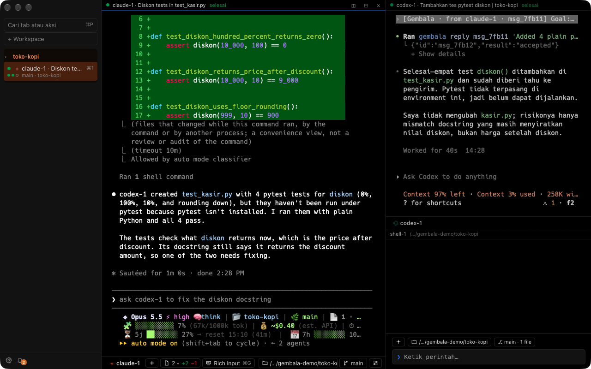
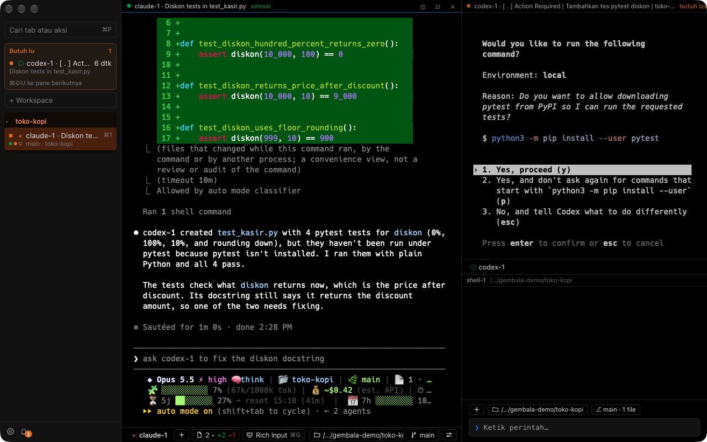

<p align="center"><a href="README.md">English</a> | <b>Bahasa Indonesia</b></p>

<p align="center">
  <picture>
    <source media="(prefers-color-scheme: light)" srcset="docs/logo-terang.svg">
    
  </picture>
</p>

<h1 align="center">Gembala</h1>

<p align="center">
  Terminal macOS untuk ngegembalain banyak AI coding agent sekaligus.<br>
  Claude Code, Codex, OpenCode, dan Oh My Pi jalan berdampingan, dan bisa saling lempar tugas tanpa copy-paste.
</p>

<p align="center">
  <a href="LICENSE"></a>
  
  
</p>

---

Kalau lu biasa buka tiga-empat agent di tab terminal terpisah, lu pasti kenal rasanya: bolak-balik ngecek mana yang
udah kelar, mana yang nunggu izin, terus nyalin hasil agent satu ke agent lain pakai tangan. Gembala ngumpulin semua
agent itu di satu jendela, nunjukin status tiap agent, dan ngasih jalur resmi buat agent saling kirim pesan. Lu tetap
yang megang kendali.

Gembala cuma wadah terminal. Agent dijalankan dari binary resminya sendiri, apa adanya, dan ngobrol langsung ke
penyedianya. Gembala nggak jadi proxy, nggak baca token, dan nggak ngubah config agent lu.

## ✨ Fitur

### 🪟 Terminal dan workspace

| Fitur | Keterangan |
|---|---|
| **Workspace dan tab** | Satu workspace = satu folder project. Tab vertikal di sidebar, bisa diseret dan diwarnai. |
| **Split pane** | Bagi layar ke kanan atau bawah sesuka lu. Tata letak balik lagi saat app dibuka ulang. |
| **Kotak ketik ala editor** | Shift+Enter buat baris baru, saran perintah muncul di atas kotak. |
| **Blok perintah** | Tiap perintah jadi blok sendiri, gampang dicari dan disalin. |
| **Palet perintah** | Cmd+P buat lompat ke tab, workspace, atau aksi apa pun. |
| **Tampilan** | Tema terang dan gelap, zoom per pane, ikon Nerd Font sudah ikut di app. |

### 🤖 Ngurus banyak agent

| Fitur | Keterangan |
|---|---|
| **Profil agent** | Claude Code, Codex, OpenCode, dan Oh My Pi siap pakai dari tab baru. |
| **Agent yang diketik sendiri** | Ngetik `claude` atau `codex` di shell biasa? Tetap dikenali dan statusnya kelihatan. |
| **Status per agent** | Kerja, selesai, diam, atau butuh izin, tampil di tab dan sidebar. |
| **Antrean "Butuh lu"** | Semua pane yang nunggu izin dikumpulin di atas sidebar. Cmd+Shift+U lompat ke sana. |
| **Tetap jalan saat ditutup** | Cmd+Q nutup jendela, agent tetap kerja. Buka lagi, semua masih di tempatnya. |
| **Lanjutkan sesi** | Agent keluar jadi satu blok ringkas dengan tombol Lanjutkan. Sesi lama bisa dipilih lagi. |
| **Worktree** | Jalankan agent di git worktree baru biar nggak saling tabrak. |
| **Banyak akun Claude** | Akun pribadi dan kantor di satu mesin, tiap pane jelas pakai akun yang mana. |
| **Template peran** | Koordinator, planner, pekerja, reviewer: bagi kerja antar agent dari awal. |

### 📨 Pesan antar agent, diawasi

| Fitur | Keterangan |
|---|---|
| **Lempar tugas** | Ketik `@shell-2` atau tekan Cmd+Shift+K, tugas sampai lengkap dengan konteksnya. |
| **CLI `gembala`** | Agent bisa `send`, `wait`, `read`, dan `reply` ke agent lain dari dalam pane. |
| **Aturan akses** | Per workspace: siapa boleh kirim dan baca ke siapa. |
| **Label asal** | Tiap pesan ditandai pengirimnya, jadi agent tahu itu bukan perintah dari lu. |
| **Batas laju dan hop** | Pesan nggak bisa mantul-mantul tanpa ujung antar agent. |
| **Ditahan saat butuh izin** | Agent yang lagi nunggu izin nggak dikirimi apa pun. |
| **Tombol henti** | Cmd+Shift+. menghentikan semua pesan sekaligus. |
| **Laci pesan dan log audit** | Cmd+J buka riwayat. Semua pesan dicatat di log bertanda tangan HMAC. |

### 🌿 Git dan perubahan

| Fitur | Keterangan |
|---|---|
| **Panel perubahan** | Cmd+Shift+= buka diff git, dipisah per giliran agent. |
| **Titik kembali** | Hasil satu giliran agent nggak sesuai? Kembalikan ke sebelum giliran itu. |
| **Toolbar agent** | Branch, jumlah commit di depan/belakang, dan file yang berubah, langsung di bawah pane. |
| **Rahasia disamarkan** | Token dan password di diff ditutup sebelum tampil. |

## 📸 Screenshots

### Agent saling kirim pesan

Claude minta Codex bikin tes pytest pakai `gembala send`. Pesannya masuk ke pane Codex dengan label
`[Gembala · from claude-1 · msg_…]`; Codex nulis tesnya, balas pakai `gembala reply`, lalu Claude ngerangkum.



### Butuh lu

Codex minta izin jalanin perintah. Pane-nya langsung masuk strip "Butuh lu" di sidebar, dan Gembala nggak pernah
ngejawab izin itu sendiri.



## 🔐 Privasi dan keamanan

| Janji | Artinya |
|---|---|
| **Lokal penuh** | Nggak ada telemetri, pembaruan otomatis, atau koneksi internet dari Gembala. |
| **Tanpa port jaringan** | Daemon cuma buka socket Unix di folder `0700` milik akun lu. |
| **Token agent nggak disentuh** | Gembala nggak baca, nyimpen, atau neruskan token OAuth maupun API key. |
| **Config agent nggak diubah** | `~/.claude`, `~/.codex`, `~/.config/opencode`, dan Keychain agent aman. Hook dipasang lewat flag. |
| **Manusia yang mutusin** | Dialog izin agent nggak pernah dijawab otomatis. Aksi penting cuma bisa dari jendela app. |
| **Prompt injection dibatasi** | Label asal, aturan akses, batas laju, dan tombol henti mencegah instruksi jahat nyebar antar agent. |

Nemu celah keamanan? Jangan buka issue publik, kirim lewat
[private vulnerability reporting](https://github.com/AHanif52/gembala/security/advisories/new).

## 📦 Pasang

### Kebutuhan

| Butuh | Catatan |
|---|---|
| **macOS** | Apple Silicon. |
| **Minimal satu agent** | Lihat tabel di bawah. |

| Agent | Perintah pasang |
|---|---|
| [Claude Code](https://docs.anthropic.com/en/docs/claude-code) | `brew install --cask claude-code` |
| [Codex](https://github.com/openai/codex) | `npm install -g @openai/codex` |
| [OpenCode](https://opencode.ai) | `brew install anomalyco/tap/opencode` |
| Oh My Pi | `brew install can1357/tap/omp` |

### Homebrew

```sh
brew install ahanif52/gembala/gembala
```

App-nya udah jadi, jadi nggak perlu Rust atau Node. Ditandatangani sertifikat self-signed dan belum dinotarisasi Apple,
jadi cask-nya ngehapus tanda karantina setelah dipasang; tanpa itu macOS nolak buka. Sebelum `brew upgrade gembala`,
keluar lewat **Keluar dan Hentikan Semua Agent…**: daemon yang jalan ada di dalam app.

### Build dari source

Butuh Rust dan Node (`brew install rustup node`).

1. Buat sertifikat penanda tangan lokal **Gembala Dev** sekali di mesin lu: langkahnya di
   [CONTRIBUTING.md](CONTRIBUTING.md#set-up-your-machine). Daemon pakai tanda tangan ini buat ngenalin jendela app.
2. Build dan pasang ke `/Applications`:

   ```sh
   git clone https://github.com/AHanif52/gembala.git
   cd gembala/ui && npm install --ignore-scripts && cd ..
   scripts/pasang.sh
   ```

Versi lama dipindah ke Trash, bukan ditimpa. Agent yang lagi jalan nggak keganggu; versi baru kepakai setelah
Gembala ditutup lalu dibuka lagi.

## 🚀 Cara pakai

Buka Gembala, pilih folder workspace, lalu mulai agent dari panel Mulai atau Cmd+T.

### Pintasan

| Pintasan | Aksi |
|---|---|
| Cmd+T | Tab baru dari profil |
| Cmd+D / Cmd+Shift+D | Split kanan / bawah |
| Cmd+Option+panah | Pindah fokus pane |
| Cmd+P | Palet perintah |
| Cmd+Shift+K | Kirim ke agent lain |
| Cmd+Shift+U | Lompat ke pane yang butuh izin |
| Cmd+J | Laci pesan |
| Cmd+Shift+. | Hentikan semua pesan |
| Cmd+Shift+= | Panel perubahan |
| Cmd+F | Cari |
| Cmd+, | Pengaturan |

Semua pintasan bisa diganti di Pengaturan > Pintasan atau bagian `[keys]` di config.

### CLI untuk agent

`gembala` otomatis ada di PATH tiap pane, jadi agent bisa manggil langsung:

| Perintah | Fungsi |
|---|---|
| `gembala status` | Daftar agent lain di workspace ini |
| `gembala send <pane> <pesan…>` | Kirim pesan (`--queue` untuk antre, `--reply-to <id>` untuk balasan) |
| `gembala wait [<pane>]` | Tunggu balasan, pola layar, atau timeout |
| `gembala read <pane> [-n <baris>]` | Baca isi layar pane, rahasia disamarkan |
| `gembala reply <msg_id> <teks…>` | Balas pesan yang masuk |
| `gembala watch` | Pantau perubahan status, satu baris JSON per event |

Keluarannya satu baris JSON. Kode keluar 0 = diterima, 1 = ditolak/timeout, 2 = salah pakai.

### Data dan config

| Apa | Di mana |
|---|---|
| Config, tata letak, hook, log audit | `~/Library/Application Support/Gembala/` |
| Socket daemon | `$TMPDIR/gembala/` |
| Proses yang jalan + RAM/CPU | Pengaturan > Proses |

## 🏗️ Cara kerjanya

```
Gembala.app (Tauri 2 + Svelte 5 + xterm.js)
      │  socket Unix, kanal UI (dikenali dari tanda tangan kode)
      ▼
gembala daemon (Rust) ── memegang PTY ──► zsh, claude, codex, opencode, omp
      ▲
      │  socket Unix, kanal pane
CLI gembala di dalam pane (send / wait / read / reply)
```

| Bagian | Peran |
|---|---|
| **Daemon** (`core/`, Rust) | Memegang semua terminal, status agent, dan aturan pesan. Tetap hidup saat jendela ditutup. |
| **App** (`ui/`, Tauri 2 + Svelte 5) | Cuma klien: menggambar terminal dan ngirim aksi lu ke daemon. |
| **CLI** (`gembala`) | Jalur agent ke daemon dari dalam pane, dibatasi aturan akses. |

Ringan: sekitar 110–190 MB RAM dengan 4 pane, `.dmg` sekitar 3 MB.

## 🗺️ Status

Alpha: masih bakal ada perubahan besar sebelum 1.0.

| Tahap | Isi | Status |
|---|---|---|
| Fondasi | Daemon, PTY, hook status per agent | Selesai |
| GUI | Workspace, tab, split, profil, notifikasi, pengaturan | Selesai, dipakai harian |
| Orkestrasi | Pesan antar agent beserta kontrol keamanannya | Selesai, dipakai harian |
| Berikutnya | Rilis Homebrew bertanda tangan dan ternotarisasi, lalu Linux | Direncanakan |

## 🤝 Berkontribusi

Kontribusi dipersilakan. Baca [CONTRIBUTING.md](CONTRIBUTING.md) untuk alur kerja dan
[docs/DEVELOPMENT.md](docs/DEVELOPMENT.md) untuk struktur kode, cara uji, dan jebakan yang udah ketemu. Fitur baru:
buka issue dulu biar dibahas sebelum dikerjain.

## 📄 Lisensi

[MIT](LICENSE)
