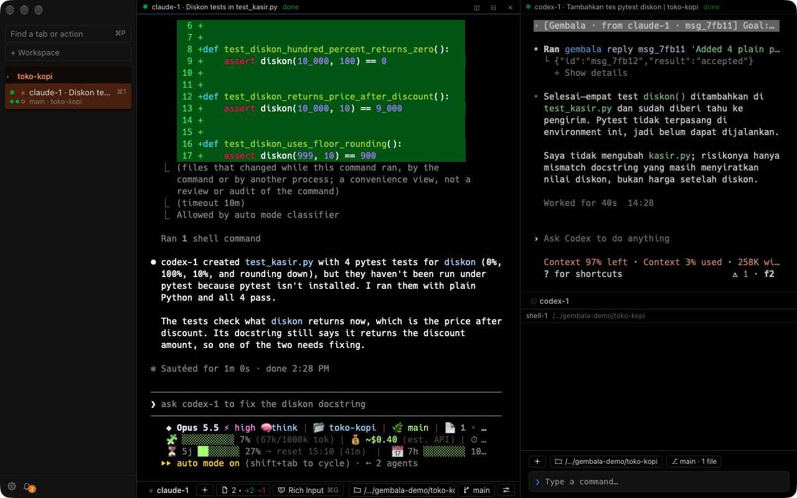
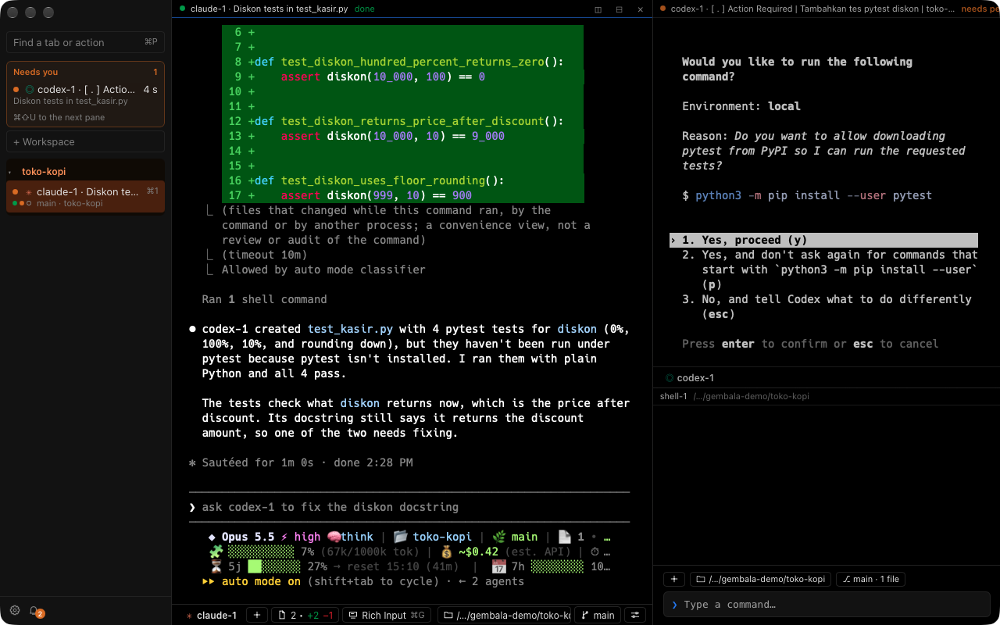

<p align="center"><b>English</b> | <a href="README.id.md">Bahasa Indonesia</a></p>

<p align="center">
  <picture>
    <source media="(prefers-color-scheme: light)" srcset="docs/logo-terang.svg">
    
  </picture>
</p>

<h1 align="center">Gembala</h1>

<p align="center">
  A macOS terminal for herding a bunch of AI coding agents at once.<br>
  Claude Code, Codex, OpenCode, and Oh My Pi run side by side and can hand each other tasks without copy-paste.
</p>

<p align="center">
  <a href="LICENSE"></a>
  
  
  
</p>

---

If you usually keep three or four agents open in separate terminal tabs, you know the drill: flipping back and forth to
check which one's done, which one's waiting for permission, then copying one agent's output into another by hand.
Gembala puts all those agents in one window, shows each agent's status, and gives them an official way to message each
other. You stay in control.

Gembala is just a terminal container. Agents run from their own official binaries, as-is, and talk straight to their
providers. Gembala isn't a proxy, doesn't read tokens, and doesn't touch your agent config.

## ✨ Features

### 🪟 Terminal and workspaces

| Feature | Description |
|---|---|
| **Workspaces and tabs** | One workspace = one project folder. Vertical tabs in the sidebar, draggable and color-coded. |
| **Split panes** | Split the screen right or down however you like. The layout comes back when you reopen the app. |
| **Editor-style input box** | Shift+Enter for a new line, command suggestions show up above the box. |
| **Command blocks** | Every command becomes its own block, easy to search and copy. |
| **Command palette** | Cmd+P to jump to any tab, workspace, or action. |
| **Look and feel** | Light and dark themes, per-pane zoom, Nerd Font icons built in. |

### 🤖 Managing many agents

| Feature | Description |
|---|---|
| **Agent profiles** | Claude Code, Codex, OpenCode, and Oh My Pi ready to go from a new tab. |
| **Agents you type yourself** | Typing `claude` or `codex` in a plain shell? Still recognized, and the status shows. |
| **Per-agent status** | Working, done, idle, or needs permission, shown on the tab and in the sidebar. |
| **"Needs you" queue** | Every pane waiting for permission is collected at the top of the sidebar. Cmd+Shift+U jumps there. |
| **Clear notifications** | Each banner says which pane, why (needs permission, waiting for an answer, failed, done…), and what to do. Answered ones go away; one switch per kind. |
| **Keeps running when closed** | Cmd+Q closes the window, agents keep working. Open it again and everything's where you left it. |
| **Resume sessions** | When an agent exits it collapses into one compact block with a Resume button. Old sessions can be picked again. |
| **Worktrees** | Run an agent in a fresh git worktree so agents don't step on each other. |
| **Multiple Claude accounts** | Personal and work accounts on one machine, with each pane clearly showing which account it uses. |
| **Role templates** | Coordinator, planner, worker, reviewer: split the work between agents from the start. |

### 📨 Messages between agents, supervised

| Feature | Description |
|---|---|
| **Hand off tasks** | Type `@shell-2` or press Cmd+Shift+K, and the task arrives with its context. |
| **`gembala` CLI** | Agents can `send`, `wait`, `read`, and `reply` to other agents from inside a pane. |
| **Access rules** | Per workspace: who may send to and read from whom. |
| **Origin label** | Every message is tagged with its sender, so the agent knows it isn't a command from you. |
| **Rate and hop limits** | Messages can't bounce between agents forever. |
| **Held while blocked** | An agent waiting for permission doesn't get sent anything. |
| **Stop button** | Cmd+Shift+. stops all messages at once. |
| **Message drawer and audit log** | Cmd+J opens the history. Every message is recorded in an HMAC-signed log. |

### 🌿 Git and changes

| Feature | Description |
|---|---|
| **Changes panel** | Cmd+Shift+= opens the git diff, split per agent turn. |
| **Restore points** | An agent turn didn't go the way you wanted? Roll back to before that turn. |
| **Agent toolbar** | Branch, commits ahead/behind, and changed files, right under the pane. |
| **Secrets masked** | Tokens and passwords in diffs are covered before they're shown. |

## 📸 Screenshots

### Agents messaging each other

Claude asks Codex for pytest tests with `gembala send`. The message lands in Codex's pane labeled
`[Gembala · from claude-1 · msg_…]`; Codex writes the tests, answers with `gembala reply`, and Claude sums it up.



### Needs you

Codex asks permission to run a command. Its pane goes straight into the "Needs you" strip in the sidebar, and Gembala
never answers that permission prompt on its own.



## 🔐 Privacy and security

| Promise | What it means |
|---|---|
| **Fully local** | No telemetry, auto-updates, or internet connections from Gembala. |
| **No network ports** | The daemon only opens Unix sockets in a `0700` folder owned by your account. |
| **Agent tokens untouched** | Gembala doesn't read, store, or forward OAuth tokens or API keys. |
| **Agent config untouched** | `~/.claude`, `~/.codex`, `~/.config/opencode`, and the agents' Keychain items are safe. Hooks are installed via flags. |
| **Humans decide** | Agent permission dialogs are never answered automatically. Important actions only work from the app window. |
| **Prompt injection contained** | Origin labels, access rules, rate limits, and the stop button keep malicious instructions from spreading between agents. |

Found a security hole? Don't open a public issue, send it through
[private vulnerability reporting](https://github.com/AHanif52/gembala/security/advisories/new).

## 📦 Install

### Requirements

| You need | Notes |
|---|---|
| **macOS** | Apple Silicon. |
| **At least one agent** | See the table below. |

| Agent | Install command |
|---|---|
| [Claude Code](https://docs.anthropic.com/en/docs/claude-code) | `brew install --cask claude-code` |
| [Codex](https://github.com/openai/codex) | `npm install -g @openai/codex` |
| [OpenCode](https://opencode.ai) | `brew install anomalyco/tap/opencode` |
| Oh My Pi | `brew install can1357/tap/omp` |

### Homebrew

```sh
brew install ahanif52/gembala/gembala
```

The app comes prebuilt, so you don't need Rust or Node. It's signed with a self-signed certificate and not notarized by
Apple, so the cask removes the quarantine flag after installing; otherwise macOS refuses to open it.
Before `brew upgrade gembala`, quit with **Quit and Stop All Agents…**: the running daemon lives inside the app.

### Build from source

Needs Rust and Node (`brew install rustup node`).

1. Create the local signing certificate **Gembala Dev** once on your machine: the steps are in
   [CONTRIBUTING.md](CONTRIBUTING.md#set-up-your-machine). The daemon uses this signature to recognize the app window.
2. Build and install to `/Applications`:

   ```sh
   git clone https://github.com/AHanif52/gembala.git
   cd gembala/ui && npm install --ignore-scripts && cd ..
   scripts/pasang.sh
   ```

The old version is moved to the Trash, not overwritten. Agents that are running aren't disturbed; the new version
takes effect after you quit Gembala and open it again.

## 🚀 Usage

Open Gembala, pick a workspace folder, then start an agent from the Start panel or with Cmd+T.

### Shortcuts

| Shortcut | Action |
|---|---|
| Cmd+T | New tab from a profile |
| Cmd+D / Cmd+Shift+D | Split right / down |
| Cmd+Option+arrow | Move pane focus |
| Cmd+P | Command palette |
| Cmd+Shift+K | Send to another agent |
| Cmd+Shift+U | Jump to the pane that needs permission |
| Cmd+J | Message drawer |
| Cmd+Shift+. | Stop all messages |
| Cmd+Shift+= | Changes panel |
| Cmd+F | Search |
| Cmd+, | Settings |

Every shortcut can be changed in Settings > Shortcuts or in the `[keys]` section of the config.

### CLI for agents

`gembala` is on the PATH in every pane, so agents can call it directly:

| Command | What it does |
|---|---|
| `gembala status` | List the other agents in this workspace |
| `gembala send <pane> <message…>` | Send a message (`--queue` to queue it, `--reply-to <id>` for a reply) |
| `gembala wait [<pane>]` | Wait for a reply, a screen pattern, or a timeout |
| `gembala read <pane> [-n <lines>]` | Read the pane's screen, secrets masked |
| `gembala reply <msg_id> <text…>` | Reply to an incoming message |
| `gembala close <pane>` | Close a helper pane you opened (not while it works or asks) |
| `gembala watch` | Watch status changes, one JSON line per event |

Output is one JSON line. Exit code 0 = accepted, 1 = rejected/timeout, 2 = misuse.

### Data and config

| What | Where |
|---|---|
| Config, layout, hooks, audit log | `~/Library/Application Support/Gembala/` |
| Daemon sockets | `$TMPDIR/gembala/` |
| Running processes + RAM/CPU | Settings > Processes |

## 🏗️ How it works

```
Gembala.app (Tauri 2 + Svelte 5 + xterm.js)
      │  Unix socket, UI channel (recognized by code signature)
      ▼
gembala daemon (Rust) ── holds the PTYs ──► zsh, claude, codex, opencode, omp
      ▲
      │  Unix socket, pane channel
gembala CLI inside the pane (send / wait / read / reply)
```

| Part | Role |
|---|---|
| **Daemon** (`core/`, Rust) | Holds all terminals, agent status, and message rules. Stays alive when the window closes. |
| **App** (`ui/`, Tauri 2 + Svelte 5) | Just a client: draws the terminal and sends your actions to the daemon. |
| **CLI** (`gembala`) | The agents' path to the daemon from inside a pane, limited by the access rules. |

Lightweight: around 110–190 MB of RAM with 4 panes, and the `.dmg` is about 3 MB.

## 🗺️ Status

Alpha: expect big changes before 1.0.

| Stage | What | Status |
|---|---|---|
| Foundation | Daemon, PTY, per-agent status hooks | Done |
| GUI | Workspaces, tabs, splits, profiles, notifications, settings | Done, used daily |
| Orchestration | Messages between agents with their security controls | Done, used daily |
| Next | Signed and notarized Homebrew release, then Linux | Planned |

## 🤝 Contributing

Contributions are welcome. Read [CONTRIBUTING.md](CONTRIBUTING.md) for the workflow and
[docs/DEVELOPMENT.md](docs/DEVELOPMENT.md) for code structure, how to test, and the gotchas we've already hit. New
feature? Open an issue first so it can be discussed before you build it.

Found a bug? In the app, press ⌘P and pick **Report a problem**: Gembala fills in the versions for you, you check the text, and
it opens a new GitHub issue in your browser. Nothing is sent until you press Submit there. You can also
[open an issue](https://github.com/AHanif52/gembala/issues/new/choose) directly.

## 📄 License

[MIT](LICENSE)
